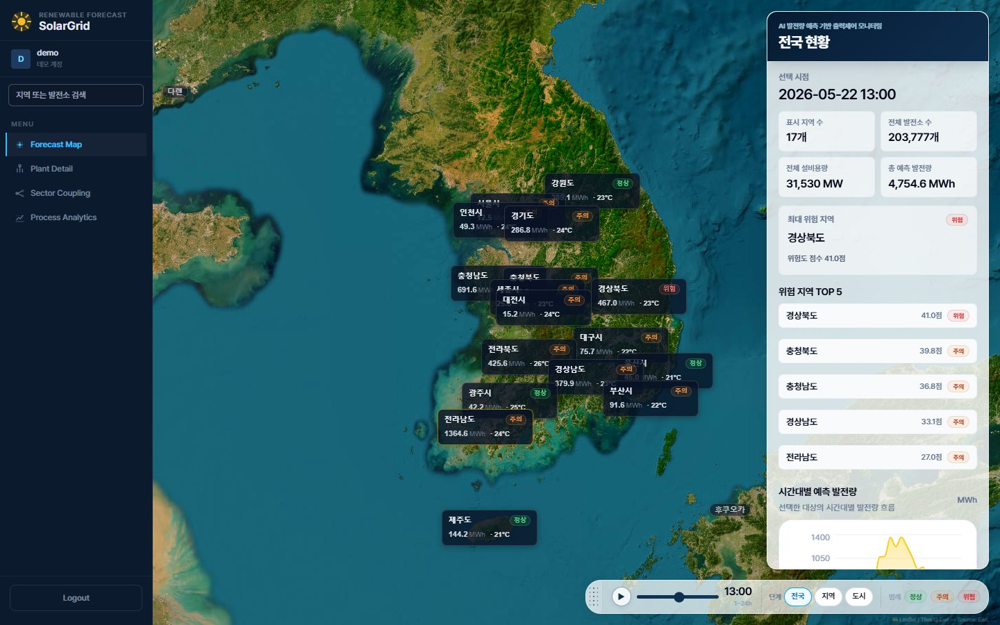
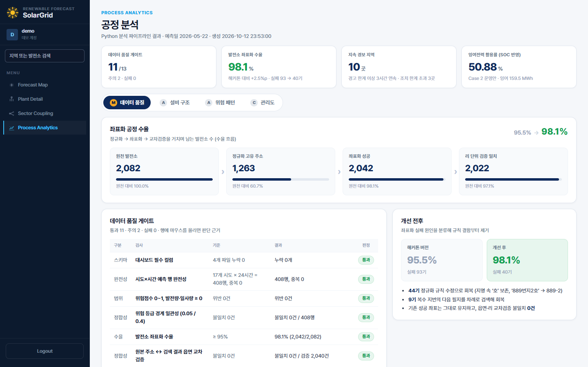
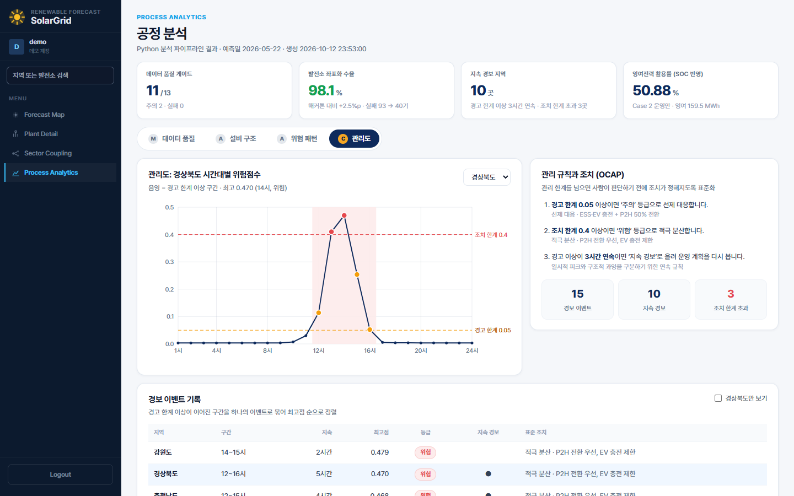
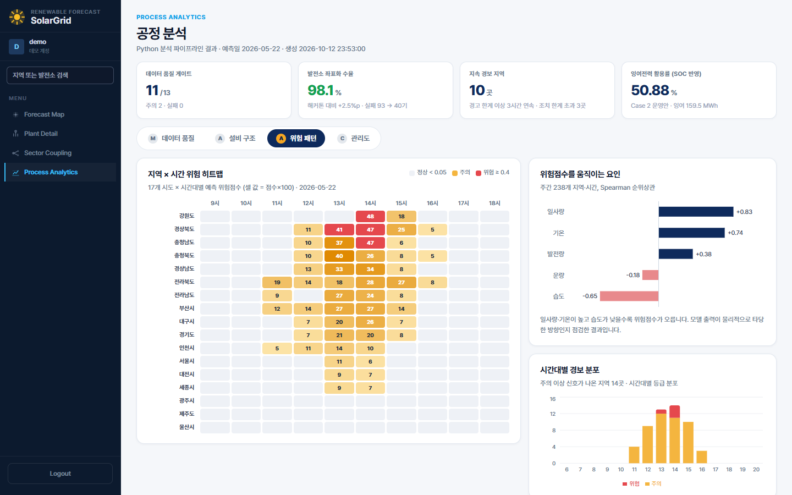
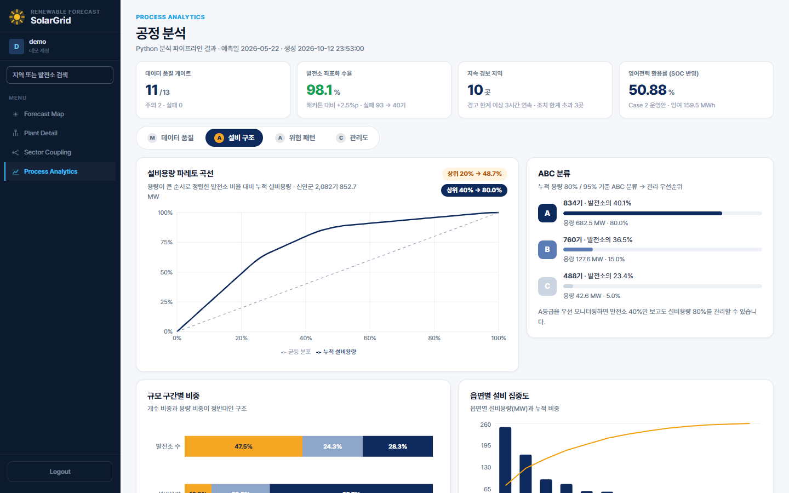
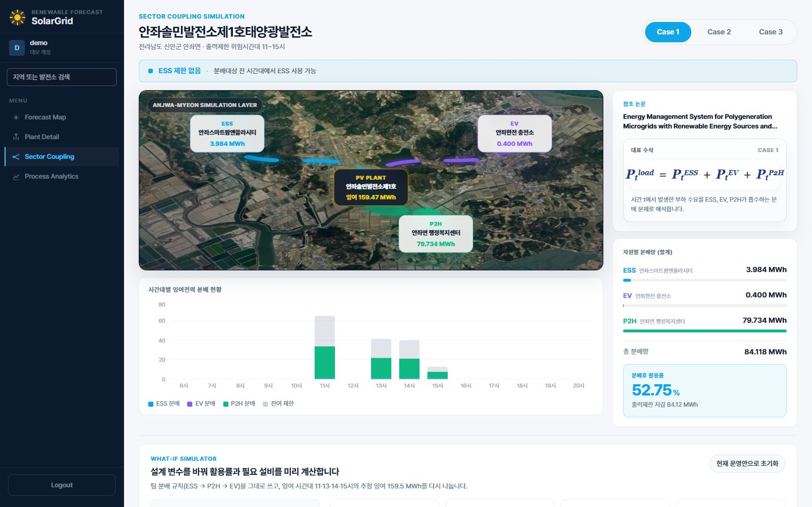
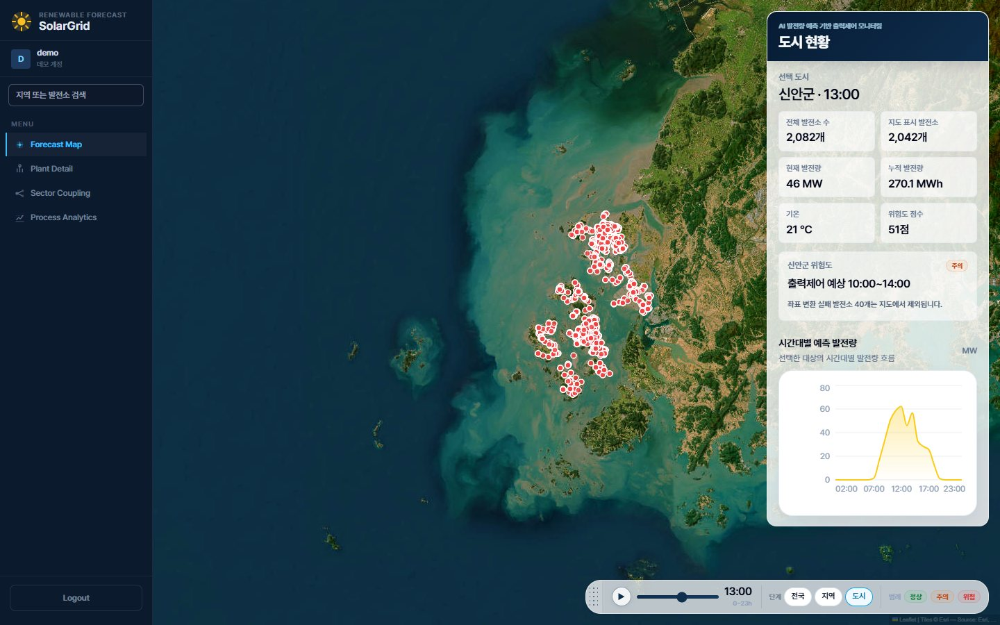
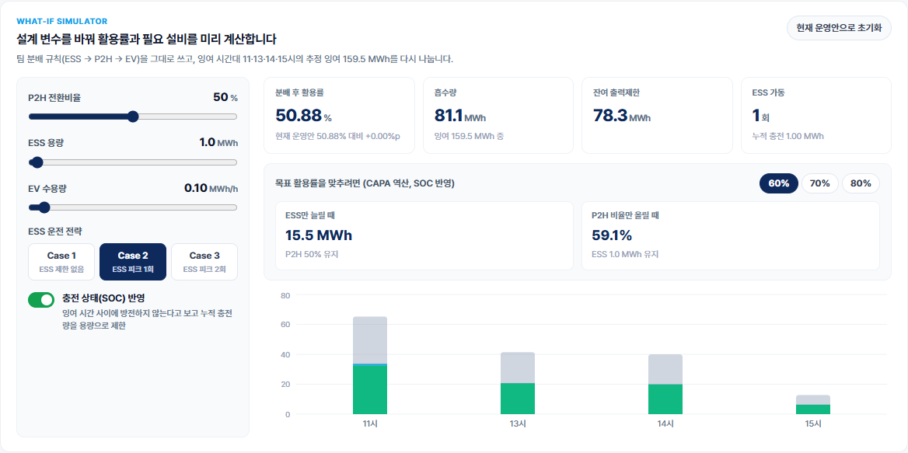
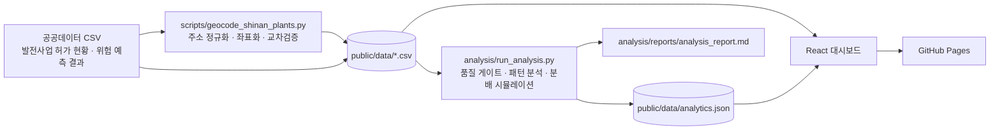

# SolarGrid · 태양광 출력제한 예측과 잉여전력 분배 시뮬레이션

[](https://github.com/SEONGBINJEON/SolarGrid/actions/workflows/ci.yml)

> 2026 영남대학교 SW·HUSS·COSS 융합 AI해커톤 · 팀 시너지온(8조)
> 해커톤 이후 **데이터 품질 관리와 공정 분석** 관점으로 고도화한 버전입니다.

**라이브 데모 → https://seongbinjeon.github.io/SolarGrid/**
로그인 화면에서 **「데모 계정으로 둘러보기」** 를 누르면 바로 들어갑니다. (데모 계정 `demo` / `solargrid`)
공정 분석 화면 바로가기: [Process Analytics](https://seongbinjeon.github.io/SolarGrid/#/analytics) ·
What-if 시뮬레이터: [Sector Coupling](https://seongbinjeon.github.io/SolarGrid/#/sector) 화면에서 「데모 발전소 바로 보기」



계통이 받아주지 못해 버려지는 태양광 전력(출력제한)을 제조 현장의 **생산 손실**로 보고,
정의 → 측정 → 분석 → 개선 → 관리(DMAIC) 흐름으로 데이터 파이프라인과 대시보드를 설계했습니다.

## 핵심 결과

| 항목 | 해커톤 버전 | 고도화 후 |
|---|---|---|
| 발전소 좌표화 수율 | 95.5% (1,989 / 2,082기) | **98.1% (2,042 / 2,082기)** |
| 좌표화 실패 | 93기 (그중 45기가 정규화 규칙 결함) | **40기 (규칙 결함 0기)** |
| 데이터 품질 게이트 | 없음 | 13개 검사 · 통과 11 · 주의 2 · 실패 0 |
| 분배 결과 검증 | 없음 | 팀 결과 재현 오차 0.0000%p, 충전 상태(SOC) 실현성 검증 |
| 잉여전력 활용률 기준값 | 52.75% (Case 1, SOC 미반영) | **50.88% (Case 2, SOC 반영 실현값)** |
| 화면 집계 정확도 | 좌표 없는 40기를 '지도 표시'로 집계 | 분석 결과와 일치 (표시 2,042 · 실패 40) |
| 자동 테스트 | 없음 | Python 34개 · JavaScript 7개, push마다 GitHub Actions 실행 |

## 화면 구성

| 화면 | 내용 |
|---|---|
| Forecast Map | 전국 → 전남 → 신안군 → 발전소 드릴다운, 시간대별 위험 등급 재생 |
| Plant Detail | 데모 발전소(안좌솔민 1호)의 시간대별 발전량·잉여전력, 연계 후보 자원 |
| Sector Coupling | ESS·EV·P2H 분배 Case 1~3 비교, **SOC 반영 활용률 열**, **What-if 시뮬레이터** |
| **Process Analytics (신규)** | 데이터 품질 · 설비 구조 · 위험 패턴 · 관리도 4개 탭 |

| 공정 분석 · 데이터 품질 | 공정 분석 · 관리도 |
|---|---|
|  |  |
| **공정 분석 · 위험 패턴** | **공정 분석 · 설비 구조** |
|  |  |
| **Sector Coupling** | **신안군 발전소 2,042기** |
|  |  |

### What-if 시뮬레이터



P2H 전환비율, ESS 용량, EV 수용량, ESS 운전 전략, SOC 반영 여부를 바꾸면
활용률과 잔여 출력제한이 즉시 다시 계산되고, 목표 활용률(60·70·80%)에 필요한 ESS 용량과 P2H 비율을 역산합니다.

## 아키텍처



- **분석 계층 (Python)**: 원천 데이터를 검사하고 분석해 결과를 JSON과 보고서로 남깁니다. 같은 입력이면 언제든 같은 숫자가 나옵니다.
- **시각화 계층 (React)**: 분석 결과를 읽어 화면에 표시하고, 분배 시뮬레이터는 브라우저에서 바로 계산합니다.
- 분배 규칙은 Python(`analysis/solargrid/allocation.py`)과 JavaScript(`src/utils/allocationSimulator.js`)에 같은 로직으로 있고, 두 언어의 테스트가 같은 기준값(팀 결과)을 검증합니다.

## 생산기술 관점의 구성 (DMAIC)

| 단계 | 구현 내용 | 제조 현장의 대응 개념 |
|---|---|---|
| Define | 출력제한을 생산 후 폐기 전력으로 정의, 핵심 지표(CTQ) 설정 | 손실 정의 · CTQ |
| Measure | 주소 정규화·좌표화 수율 관리, 13개 품질 게이트, 실패 원인 분류, 화면 집계 오류 수정 | 공정 수율 · 검사 공정 · 근본원인 분석(RCA) · 계측 오류 |
| Analyze | 설비용량 파레토·ABC 분류, 지역×시간 위험 히트맵, 기상 인자 순위상관 | 파레토 · ABC 분석 · 요인 분석 |
| Improve | 등급별 대응 규칙(OCAP), SOC 실현성 검증, 민감도 분석, 필요 설비 역산 | OCAP · 설비 수명 관리 · CAPA 산정 |
| Control | 관리도(경고 한계 0.05 · 조치 한계 0.4 · 3시간 연속 지속 경보), 경보 이벤트 기록, CI 재현성 검사 | SPC 관리도 · 연속 규칙(Run rule) · 표준 작업 |

## 개선 사례 1: 검사 규칙이 불량을 만들고 있었다

해커톤 버전의 주소 정규화는 `번지`·`호`·`외`를 주소 전체에서 지웠습니다.
그 결과 지명과 지번이 훼손되어 좌표화에 실패했습니다.

| 원본 주소 | 해커톤 규칙 결과 | 수정 규칙 결과 |
|---|---|---|
| 안좌면 내호리 222-3 | 안좌면 **내리** 222-3 (다른 마을) | 안좌면 내호리 222-3 |
| 안좌면 읍동리 889번지2호 | 읍동리 **8892** (없는 지번) | 읍동리 889-2 |
| 압해읍 복룡리 1225-35외1(1225-7) | 복룡리 **1225-351** | 복룡리 1225-35 → 실패 시 1225-7 |

실패 93기를 원인별로 분류한 결과입니다 (`analysis/solargrid/address.py`의 `classify_failure`).

| 원인 | 수정 전 | 수정 후 |
|---|---|---|
| 규칙 부작용: 지명 훼손 | 34 | 0 |
| 규칙 부작용: 지번 왜곡 | 11 | 0 |
| 복수 지번 미검색 | 13 | 5 |
| 산 지번 미검색 | 32 | 32 |
| 기타 지번 미검색 | 2 | 2 |
| 원천 표기 오류 (쉼표 누락 지번, 수기 검토) | 1 | 1 |

조치는 네 가지입니다.

1. `번지·호·외`는 숫자 뒤에 붙은 경우에만 지번 표기로 바꿉니다.
2. 복수 지번이면 첫 필지가 실패해도 다음 필지와 괄호 안 대체 필지를 차례로 검색합니다.
3. 서버 오류 같은 일시적 실패는 캐시에 남기지 않고 다시 시도합니다.
4. 읍면에 더해 리(동) 단위까지 원본 주소와 검색 결과를 교차검증합니다.

변경이 안전한지도 검증했습니다. 해커톤 규칙을 그대로 재현한 함수가 기존 결과 2,082건과 100% 일치했고,
수정 규칙이 바꾸는 주소는 모두 기존 실패 건이었습니다. 기존에 성공한 1,989기의 좌표는 하나도 바뀌지 않았습니다.
해커톤 당시 결과는 비교 기준선으로 `analysis/baseline/`에 보존했습니다.

## 개선 사례 2: 분배 시뮬레이션의 실현 가능성 검증

팀 규칙(적용순위 ESS → P2H → EV, P2H는 잉여의 50% 전환)을 재구현해 해커톤 결과를 오차 없이 재현한 뒤,
배터리 충전 상태(SOC)를 반영해 다시 계산했습니다.

| 운전 전략 | 팀 규칙 활용률 | SOC 반영 활용률 | ESS 가동 |
|---|---|---|---|
| Case 1 · ESS 제한 없음 | 52.75% | 50.88% | 4회 |
| Case 2 · ESS 피크 1회 | 50.88% | 50.88% | 1회 |
| Case 3 · ESS 피크 2회 | 51.50% | 50.88% | 2회 |

- 1 MWh급 ESS가 13~15시 연속 시간에 매번 만충하는 것은 방전 없이는 불가능합니다. 실현 가능한 기준값은 Case 2의 50.88%입니다.
- 설계 변수를 ±10% 바꾸면 P2H 전환비율은 활용률을 ±5.00%p, ESS 용량은 ±0.06%p 움직입니다.
- 목표 활용률 60·70·80%에는 ESS만 늘릴 경우 15.5·31.5·47.5 MWh, P2H 비율만 올릴 경우 59.1·69.1·79.1%가 필요합니다.

## 개선 사례 3: 계측기가 빈 값을 0으로 읽고 있었다

신안군 화면은 '지도 표시 발전소 2,082기, 좌표 변환 실패 0기'라고 표시했습니다.
분석 파이프라인의 좌표화 결과(성공 2,042기, 실패 40기)와 맞지 않았습니다.

- **원인**: 좌표화에 실패한 발전소는 CSV의 위경도가 빈 칸인데, JavaScript에서 `Number('')`는 `0`이 됩니다.
  좌표가 없는 40기가 (0, 0) 좌표를 가진 정상 데이터로 판정되어, 지도에는 보이지 않으면서 집계에만 들어갔습니다.
  검색창에서 이 발전소를 고르면 지도가 적도 부근 바다로 이동하는 증상도 같은 원인이었습니다.
- **조치**: 네 곳에 복사되어 있던 좌표 판정 함수를 `src/utils/coordinateUtils.js` 하나로 모으고, 빈 값은 '좌표 없음'으로 읽게 했습니다.
  같은 결함이 다시 생기지 않도록 테스트(`tests/coordinateUtils.test.js`)로 고정했습니다.
- **결과**: 화면 집계(표시 2,042기 · 실패 40기)가 분석 결과와 일치합니다.

## 품질 보증 (GitHub Actions)

push와 Pull Request마다 [CI 워크플로](.github/workflows/ci.yml)가 실행되고, 통과한 main만 GitHub Pages에 배포됩니다.

| 작업 | 검사 내용 |
|---|---|
| 대시보드 | ESLint, JavaScript 테스트 7개, 프로덕션 빌드 |
| 분석 파이프라인 | pytest 34개, `run_analysis.py --check` |

`--check`는 원천 데이터로 분석을 다시 돌려, 저장소에 커밋된 `analytics.json`과 숫자가 같은지 비교합니다(실행 시각 제외).
원천 데이터나 분석 코드를 바꾸고 결과 파일을 갱신하지 않으면 CI가 실패하므로, 화면의 숫자와 코드가 어긋날 수 없습니다.

## 폴더 구조

```text
solar-dashboard/
├─ .github/workflows/        CI (린트 · 테스트 · 빌드 · 분석 재현성) 와 Pages 배포
├─ analysis/                 Python 분석 파이프라인
│  ├─ solargrid/             address · allocation · patterns · quality · io 모듈
│  ├─ tests/                 pytest 테스트 34개
│  ├─ baseline/              해커톤 당시 좌표화 결과 (전후 비교 기준선)
│  ├─ reports/               자동 생성 분석 보고서
│  ├─ run_analysis.py        파이프라인 실행 진입점 (--check: 재현성 검사)
│  └─ requirements.txt       검증한 버전으로 고정
├─ scripts/
│  └─ geocode_shinan_plants.py   주소 정규화 · Kakao 좌표화 · 교차검증
├─ public/data/              원천·가공 CSV, analytics.json
├─ docs/images/              README 화면 캡처
├─ src/
│  ├─ components/analytics/  공정 분석 화면 (데이터 품질 · 설비 구조 · 위험 패턴 · 관리도)
│  ├─ components/            지도 · 발전소 상세 · 섹터커플링 · What-if 시뮬레이터
│  ├─ hooks/                 CSV · 분석 결과 로딩
│  └─ utils/                 분배 시뮬레이터 · 좌표 판정 · 위험 등급 · 시간대 계산
└─ tests/                    JavaScript 테스트 (Node 내장 테스트 러너)
```

## 실행 방법

### 대시보드

```bash
npm install
npm run dev
```

로그인 화면에서 「데모 계정으로 둘러보기」를 누릅니다. 주소 끝에 `#/analytics`, `#/sector`처럼 붙이면 해당 화면이 바로 열립니다.
GitHub Pages용 빌드는 `npm run build:pages`입니다 (`/SolarGrid/` 경로 기준).

### 분석 파이프라인 (Python 3.12)

```bash
python -m venv .venv
.venv\Scripts\activate            # macOS·Linux: source .venv/bin/activate
pip install -r analysis/requirements.txt
python analysis/run_analysis.py
python analysis/run_analysis.py --check
```

첫 명령은 `public/data/analytics.json`과 `analysis/reports/analysis_report.md`를 새로 만들고,
`--check`는 파일을 쓰지 않고 커밋된 결과와 같은지만 확인합니다 (CI와 같은 검사).

### 좌표화 다시 실행 (Kakao REST API 키 필요)

프로젝트 루트의 `.env`에 `KAKAO_REST_API_KEY`를 넣고 실행합니다. 캐시에 있는 주소는 API를 다시 호출하지 않습니다.

```bash
python scripts/geocode_shinan_plants.py --dry-run
python scripts/geocode_shinan_plants.py
```

### 테스트와 린트

```bash
npm test
python -m pytest analysis/tests -q
npm run lint
```

## 한계와 다음 단계

- 출력제한 예측 모델(XGBoost)의 학습 코드와 학습 데이터는 이 저장소에 없습니다. 모델 지표(재현율 78.65%, PR-AUC 0.452, 정밀도 16.99%)는 해커톤 당시 테스트 결과입니다.
- 위험 예측은 단일 일자(2026-05-22) 기준입니다. 계절·기상 조건별 다일자 검증이 필요합니다.
- 산 지번 32기는 Kakao 주소 검색으로 찾지 못했습니다. 지적 정보 API 같은 대체 경로가 필요합니다.
- 분배는 규칙 기반입니다. SOC·충방전·열수요 제약을 넣은 최적화(MILP)로 확장할 수 있습니다.
- 발전소별 위험도는 설비용량 기반 임시값입니다.

## 팀 시너지온

| 이름 | 전공 | 역할 |
|---|---|---|
| 전성빈 | 로봇공학과 | 플랫폼 개발 (리더) |
| 이은성 | 전자공학과 | 데이터 분석 · AI 모델링 |
| 김민서 | 에너지화공 | 기획 |
| 조민현 | 영어영문학과 | 마케팅 |
